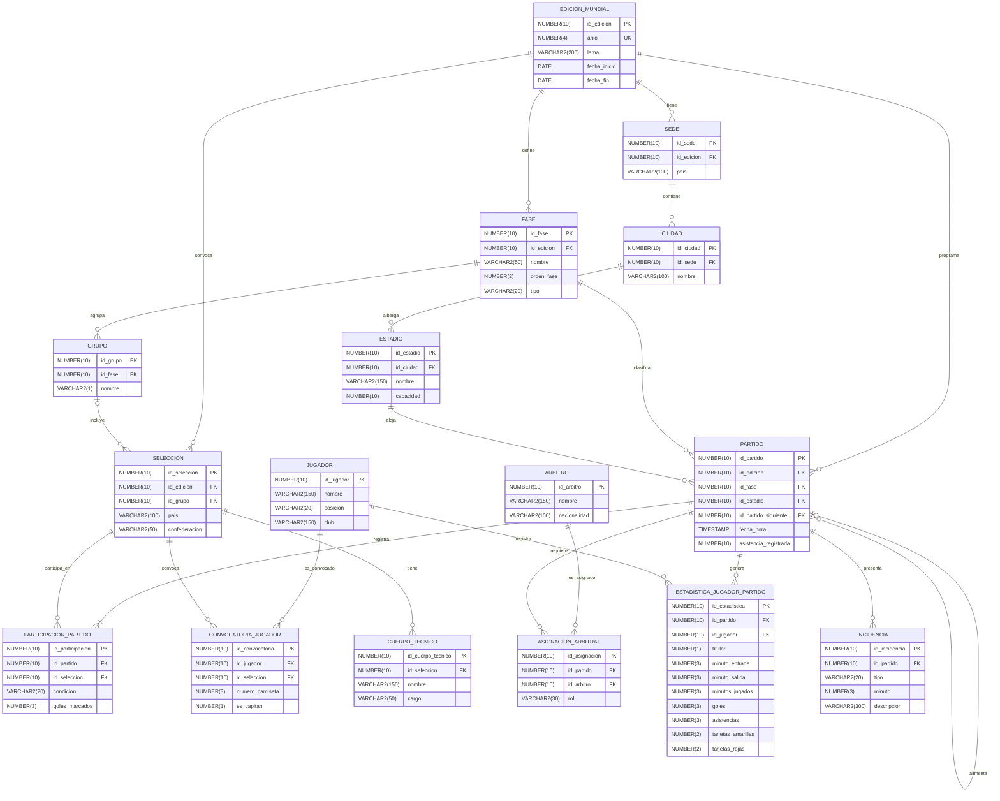

# Modelo Físico - Entrega 2
## Sistema de Información para la Gestión Integral de la Copa Mundial de la FIFA

Implementado en Oracle Database 19c (script: `sql/entrega2/ddl/ddl_modelo_ampliado.sql`).

---

## 1. Diagrama físico

---

## 2. Convenciones de nombres

| Prefijo | Objeto | Ejemplo |
|---|---|---|
| `pk_` | Llave primaria | `pk_partido` |
| `fk_` | Llave foránea | `fk_partido_estadio` |
| `uq_` | Restricción UNIQUE | `uq_partido_agenda` |
| `ck_` | Restricción CHECK | `ck_participacion_goles` |
| `ix_` | Índice | `ix_partido_fase` |

Tipos de dato: `NUMBER` para identificadores, cantidades y banderas (0/1), `VARCHAR2` para texto, `DATE` para fechas del torneo y `TIMESTAMP` para la fecha y hora de cada partido.

---

## 3. Índices automáticos

Oracle crea un índice único por cada llave primaria y por cada restricción UNIQUE. No se declaran en el script.

| Origen | Cantidad |
|---|---|
| Llaves primarias | 16 |
| Restricciones UNIQUE | 15 |

---

## 4. Índices creados explícitamente

Oracle no indexa las llaves foráneas por sí solo. Se crearon 9 índices sobre las columnas que más se usan en los `JOIN` y filtros de las consultas. Las llaves foráneas que ya son la primera columna de un UNIQUE no necesitan índice aparte.

| Índice | Tabla (columna) | Justificación |
|---|---|---|
| `ix_partido_edicion` | `partido` (`id_edicion`) | Filtrar y agrupar partidos por edición |
| `ix_partido_fase` | `partido` (`id_fase`) | Resultados y conteos por fase |
| `ix_partido_siguiente` | `partido` (`id_partido_siguiente`) | Recorrer el cuadro eliminatorio |
| `ix_participacion_seleccion` | `participacion_partido` (`id_seleccion`) | Partidos y goles por selección |
| `ix_estadistica_jugador` | `estadistica_jugador_partido` (`id_jugador`) | Goleadores y rendimiento por jugador |
| `ix_asignacion_arbitro` | `asignacion_arbitral` (`id_arbitro`) | Historial de partidos de un árbitro |
| `ix_incidencia_partido` | `incidencia` (`id_partido`) | Incidencias de un partido |
| `ix_seleccion_grupo` | `seleccion` (`id_grupo`) | Selecciones de un grupo y tabla de posiciones |
| `ix_cuerpo_tecnico_seleccion` | `cuerpo_tecnico` (`id_seleccion`) | Cuerpo técnico de una selección |

Total de índices en el modelo: 16 + 15 + 9 = 40.
