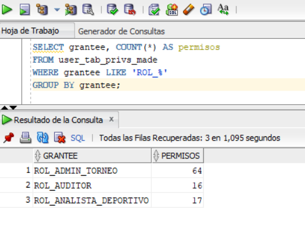
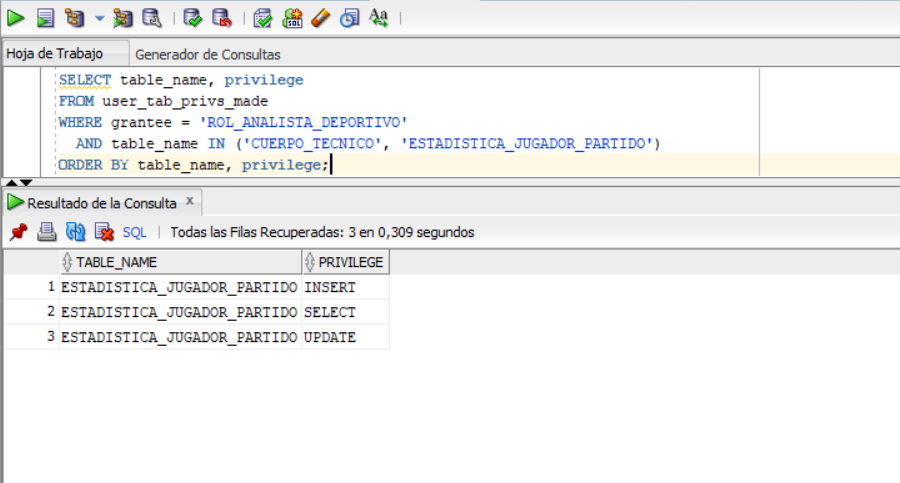

# Roles y Privilegios - Entrega 2
## Sistema de Información para la Gestión Integral de la Copa Mundial de la FIFA

El script está en `sql/entrega2/roles/roles_privilegios.sql` y los casos de prueba en `tests/entrega2/casos_prueba.md`.

---

## 1. Principio de diseño

Se aplica el **principio de mínimo privilegio**: cada rol recibe solo los permisos que su trabajo necesita. Los permisos se asignan a roles y los roles a usuarios, no directamente a los usuarios.

---

## 2. Roles definidos

| Rol | Usuario de prueba | Función |
|---|---|---|
| `rol_admin_torneo` | `usuario_admin_torneo` | Administra la información del torneo |
| `rol_analista_deportivo` | `usuario_analista` | Consulta información deportiva y carga estadísticas |
| `rol_auditor` | `usuario_auditor` | Consulta todo el modelo, sin modificar nada |

---

## 3. Matriz de permisos

| Tabla | Administrador | Analista | Auditor |
|---|---|---|---|
| edicion_mundial, sede, ciudad, estadio, fase, grupo | SELECT, INSERT, UPDATE, DELETE | SELECT | SELECT |
| seleccion, jugador, convocatoria_jugador, arbitro | SELECT, INSERT, UPDATE, DELETE | SELECT | SELECT |
| partido, participacion_partido, asignacion_arbitral, incidencia | SELECT, INSERT, UPDATE, DELETE | SELECT | SELECT |
| cuerpo_tecnico | SELECT, INSERT, UPDATE, DELETE | Sin acceso | SELECT |
| estadistica_jugador_partido | SELECT, INSERT, UPDATE, DELETE | SELECT, INSERT, UPDATE | SELECT |

---

## 4. Justificación

- **Administrador:** es el único que puede crear, modificar y borrar datos del torneo. El borrado queda limitado por las llaves foráneas del modelo (por ejemplo, no se puede borrar una selección con partidos).
- **Analista:** necesita leer el modelo deportivo y registrar estadísticas, por eso es el único rol, además del administrador, con INSERT y UPDATE, y solo sobre `estadistica_jugador_partido`. No accede a `cuerpo_tecnico`, que no hace parte del análisis deportivo.
- **Auditor:** solo lectura sobre las 16 tablas. Cuando exista la tabla de auditoría (Entrega 3) será el único rol con acceso a ella, para que la bitácora sea confiable.

---

## 5. Sentencias usadas

| Sentencia | Uso |
|---|---|
| `CREATE ROLE` | Crea cada rol |
| `GRANT ... ON tabla TO rol` | Asigna permisos al rol |
| `CREATE USER` y `GRANT CREATE SESSION` | Crea el usuario de prueba y le permite conectarse |
| `GRANT rol TO usuario` | Entrega el rol al usuario |

---

## 6. Verificación en el catálogo de Oracle

Se consultó `user_tab_privs_made` con el dueño de las tablas (`IS101007`).

**Consulta 1: permisos otorgados a cada rol**

```sql
SELECT grantee, COUNT(*) AS permisos
FROM user_tab_privs_made
WHERE grantee LIKE 'ROL_%'
GROUP BY grantee;
```

| Rol | Permisos | Cálculo |
|---|---|---|
| ROL_ADMIN_TORNEO | 64 | 4 permisos (SELECT, INSERT, UPDATE, DELETE) × 16 tablas |
| ROL_AUDITOR | 16 | 1 permiso (SELECT) × 16 tablas |
| ROL_ANALISTA_DEPORTIVO | 17 | SELECT en 14 tablas + SELECT, INSERT y UPDATE en `estadistica_jugador_partido` |

Los tres valores coinciden con la matriz de la sección 3.



**Consulta 2: el analista sobre `cuerpo_tecnico` y `estadistica_jugador_partido`**

```sql
SELECT table_name, privilege
FROM user_tab_privs_made
WHERE grantee = 'ROL_ANALISTA_DEPORTIVO'
  AND table_name IN ('CUERPO_TECNICO', 'ESTADISTICA_JUGADOR_PARTIDO')
ORDER BY table_name, privilege;
```

Resultado: 3 filas, todas de `ESTADISTICA_JUGADOR_PARTIDO` (INSERT, SELECT, UPDATE) y ninguna de `CUERPO_TECNICO`. Se confirma que el analista puede cargar estadísticas y no tiene acceso al cuerpo técnico. El script ya deja definidos los tres usuarios, así que esas pruebas se pueden correr apenas se tenga ese privilegio.



---

## 7. Pruebas con usuarios

Los permisos de cada rol se comprobaron en el catálogo de Oracle (sección 6). Para crear los usuarios se necesita el privilegio `CREATE USER`, que el usuario del grupo (`IS101009`) no tiene en el servidor del curso. El script ya deja definidos los tres usuarios, así que esas pruebas se pueden correr apenas se tenga ese privilegio.
