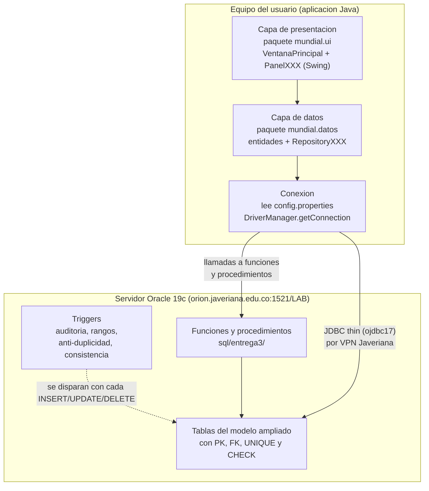

# Arquitectura de la aplicacion

## Stack tecnologico

| Capa | Tecnologia | Version |
|---|---|---|
| Interfaz | Java Swing | JDK 21 |
| Acceso a datos | JDBC con el driver thin de Oracle (`ojdbc17`) | 23.8 |
| Construccion | Maven | 3.9 |
| Base de datos | Oracle Database | 19c, servidor `orion.javeriana.edu.co`, servicio `LAB` |

Escogimos una aplicacion de escritorio en Java porque JDBC fue la tecnologia de conexion que se
vio en clase (presentacion 19) y porque asi la aplicacion queda en un solo proyecto, sin servidor
web aparte. El driver es de tipo 4 (thin): esta escrito en Java y habla directo con Oracle por red,
sin instalar el cliente de Oracle en cada equipo.

## Diagrama

## Capas

**Presentacion (`mundial.ui`).** `VentanaPrincipal` tiene la barra de menus y una pantalla de
inicio con los modulos del enunciado: catalogos, partidos, consultas y reportes. Cada opcion cambia el contenido de la ventana
por un panel. Los paneles solo muestran datos y piden datos al usuario; no tienen SQL.

**Datos (`mundial.datos`).** Seguimos el patron DAO de la presentacion 19. Por cada tabla hay una
clase entidad (por ejemplo `Estadio`) con atributos privados, getters y setters, y una clase
`RepositoryEstadio` con los metodos `consultar`, `insertar`, `actualizar` y `eliminar`. El SQL se
arma con `StringBuilder` y siempre se ejecuta con `PreparedStatement`. Los valores que escribe el
usuario entran como parametros (`?`), nunca pegados al texto de la consulta, y por eso no hay riesgo
de inyeccion SQL.

**Conexion (`mundial.Conexion`).** Lee la URL, el usuario y la contrasena de `config.properties` y
devuelve una `Connection` de `DriverManager`. Cada metodo de los repositorios abre su conexion en un
try-with-resources, de modo que `Connection`, `PreparedStatement` y `ResultSet` se cierran solos aun
si ocurre un error. No usamos pool de conexiones: con un solo usuario a la vez no hace falta.

**Base de datos.** Las reglas del negocio viven en Oracle y no en Java. Si alguien intenta guardar
un estadio con 10 personas de aforo, lo detiene `ck_estadio_capacidad`. Si intenta borrar una sede
que todavia tiene ciudades, lo detiene `fk_ciudad_sede`. La aplicacion no repite esas validaciones;
muestra el mensaje que devuelve Oracle. Lo mismo pasa con los triggers de la Entrega 3: se disparan
en el servidor con cada operacion que haga la aplicacion, sin que la aplicacion tenga que llamarlos.

## Decisiones

| Decision | Motivo |
|---|---|
| Credenciales en `config.properties`, fuera del repositorio | Cada integrante usa su propio usuario Oracle y ninguna contrasena queda en GitHub |
| Id nuevo con `NVL(MAX(id)) + 1` dentro del mismo `INSERT` | Las tablas de la Entrega 2 no tienen secuencias. Si dos usuarios guardan al mismo tiempo, la PK rechaza al segundo con `ORA-00001` |
| Autocommit de JDBC activo en los catalogos | Cada operacion de catalogo es una sola sentencia, asi que no hay nada que agrupar en una transaccion |
| Errores de Oracle explicados en palabras simples | La clase `Mensajes` traduce los codigos mas comunes (`ORA-00001`, `ORA-02290`, `ORA-02292`, falta de VPN) y debajo deja el mensaje original de Oracle |
| Cada accion deja un mensaje abajo de la tabla | Despues de agregar, editar o eliminar, el panel dice que paso, selecciona la fila afectada y sugiere el siguiente paso (por ejemplo, agregar las ciudades de una sede nueva) |
| Listas desplegables para la tabla padre | Al crear una ciudad se escoge la sede de una lista, no se escribe su id. Asi no se puede escoger una sede que no existe |

## Flujo de una operacion

Ejemplo: el usuario crea un estadio.

1. En `PanelEstadios` pulsa "Nuevo", escoge la ciudad de la lista, escribe nombre y capacidad.
2. El panel arma un objeto `Estadio` y llama a `RepositoryEstadio.insertarEstadio`.
3. El repositorio abre la conexion, prepara el `INSERT ... SELECT NVL(MAX(id_estadio), 0) + 1, ?, ?, ?`
   y asigna los tres parametros con `setInt` y `setString`.
4. Oracle revisa la FK a `ciudad`, el `UNIQUE (id_ciudad, nombre)` y el `CHECK` de capacidad.
5. Si todo pasa, el panel recarga la tabla. Si no, muestra el error de Oracle.
